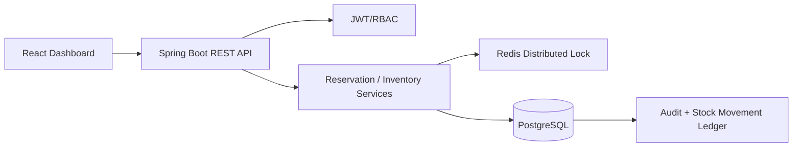

# FEFO Inventory & Expiry Management System

Production-oriented full-stack warehouse MVP implementing First-Expiry-First-Out allocation, reservation holds, Redis distributed locking, PostgreSQL transactional inventory, JWT RBAC, audit history, React dashboard, and a FEFO-vs-LIFO simulation.

## Stack
- Java 21, Spring Boot 3, Spring MVC, Spring Data JPA/Hibernate
- Spring Security + JWT, PostgreSQL, Flyway, Redis/Lettuce
- React + Vite + TypeScript, React Query, React Router, Tailwind CSS
- JUnit 5, Mockito, MockMvc, Testcontainers
- Docker Compose, GitHub Actions

## Architecture


PostgreSQL is the source of truth for stock. Redis coordinates concurrent writers. Reservation allocation acquires the Redis product lock first, then opens the short database transaction and locks eligible batch rows with `FOR UPDATE`.

## Run everything
1. Copy `.env.example` to `.env` and replace secrets for non-local use.
2. Run:
```bash
docker compose up --build
```
3. Frontend: http://localhost
4. API: http://localhost:8080
5. Swagger: http://localhost:8080/swagger-ui.html
6. Health: http://localhost:8080/actuator/health

Demo users created by Flyway:
- `staff / password`
- `admin / password`

Change seeded/demo credentials before deploying anywhere real.

## FEFO behavior
A reservation locks a product, loads non-expired batches ordered by expiry ascending using pessimistic row locks, and splits the requested quantity across batches. If stock is insufficient, the transaction rolls back and no partial reservation remains.

## Reservation lifecycle
`RESERVED -> CONFIRMED | CANCELLED | EXPIRED`

Reservation holds last 15 minutes by default. Redis lock TTL is 30 seconds and is only a distributed coordination mechanism; PostgreSQL remains authoritative for the 15-minute business hold. A scheduled worker releases expired holds every 30 seconds.

## Idempotency
Reservation creation and confirmation/cancellation accept `Idempotency-Key`. The request hash is persisted in PostgreSQL so a retry returns the original response instead of creating a second reservation. Reusing a key with a different request is a conflict.

## Tests
Backend:
```bash
cd backend
mvn test
```
The integration suite starts PostgreSQL and Redis Testcontainers. It includes a 200-concurrent-request test against the same product/batch and asserts that successful reservations never exceed available inventory.

Frontend:
```bash
cd frontend
npm install
npm test
npm run build
```

The local environment used to package this repository does not have Maven installed, so a local Maven test execution was not claimed here. GitHub Actions and the backend Docker build provide reproducible Java 21/Maven verification.

## Standalone FEFO vs LIFO benchmark
The deterministic simulation generates its own dataset and prints measured results:
```bash
python scripts/benchmark.py --runs 1000 --seed 42 --reservation 50
```
No benchmark percentage is hardcoded into the project or README.

The application also exposes an ADMIN endpoint:
`POST /api/v1/benchmarks/fefo-vs-lifo`

Example:
```json
{"productId":"10000000-0000-0000-0000-000000000001","runs":1000,"reservationQuantity":50}
```

## Security
- Stateless JWT authentication
- ADMIN/STAFF role authorization
- BCrypt password hashing
- Explicit CORS origins
- Validation on incoming requests
- RFC 7807-style `ProblemDetail` error responses
- Idempotency keys hashed and persisted
- No stock authority in Redis

## Performance/scaling decisions
- FEFO index: `(product_id, expiry_date)` plus partial available-stock index
- Pessimistic row locking only during inventory mutation
- Server-side pagination is the intended API contract for large tables; current MVP dashboard endpoints are bounded for operational views
- Immutable audit/stock movement tables can be time-partitioned when they become large
- Redis locks are scoped to a product for reservation allocation and to a reservation for lifecycle operations
- React Query owns server state to reduce duplicate requests and stale local copies

## Load testing
With k6 installed:
```bash
k6 run scripts/load-test.js
```
The script checks login, product retrieval, and concurrent reservation behavior. Use it against a disposable environment, not production.

## Resume metrics
Do not copy benchmark or concurrency numbers into a resume unless you have actually run the included tests/benchmark and recorded the output. The repository deliberately generates those measurements instead of inventing them.
